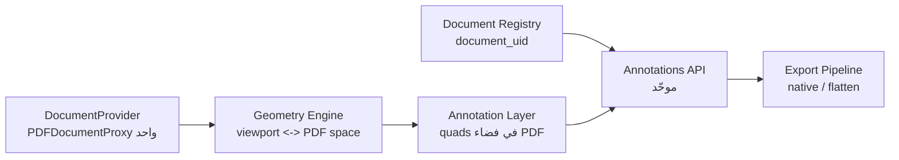

# تقرير استراتيجي: رفع جودة التحرير والتعليق على PDF في مَتن

آخر تحديث: 2026-10-11
النطاق: قارئ مَتن التفاعلي وسير عمل التعليقات والتصدير (لا يشمل استبدال محرّك PDF)
مرتبط بـ: [REVIEW_ENHANCEMENTS_PLAN.md](../REVIEW_ENHANCEMENTS_PLAN.md)، [STATUS.md](../STATUS.md)، [DECISIONS.md](../DECISIONS.md)

---

## 1. الملخّص التنفيذي

التحسينات السابقة (المراحل 1–5) رفعت الاستقرار والأداء بشكل ملموس، لكنها حافظت على **نموذج تعليقات هشّ** بُني فوق إحداثيات شاشة مُعيارية وطبقتي بيانات منفصلتين. النتيجة أن «التحرير والتعليق» يبدوان غير مكتملين لأن المشكلة ليست في الأزرار أو الواجهة، بل في **الأساس**: كيف نُعرّف المستند، وكيف نُمثّل هندسة التعليق، وكيف نوحّد مصادر التعليقات.

التوصية الأساسية: الانتقال من «طبقة SVG فوق الصفحة» إلى **محرك تعليقات واعٍ بفضاء PDF**، مع **هوية مستند ثابتة (بصمة)**، و**نموذج موحّد للتعليقات** يجمع ملاحظات مَتن وتعليقات PDF الأصلية، ثم بناء تجربة تحرير كاملة فوق هذا الأساس. هذا هو الفرق بين «يعمل غالبًا» و«يعمل دائمًا».

---

## 2. تقييم الوضع الراهن

| القدرة | الحالة | الملف/الدليل |
| --- | --- | --- |
| عرض الصفحات مع افتراضية | جيد | `InteractivePDFViewer.tsx` (نافذة ±2) |
| التخطيطات والتقريب والملاءمة | جيد | `readerPrefs.ts` + العرض |
| تحديد النص وإنشاء تظليل/تسطير | يعمل لكن هشّ | `PDFPageRenderer.tsx` (`handleMouseUp`) |
| هندسة التعليق | **هشّة**: إحداثيات شاشة مُعيارية | `getClientRects() ÷ wrapperRect` |
| تصدير أصلية/مسطّحة | يعمل مع قيود خطوط | `annotation_modifier_service.py` |
| ملاحظات مَتن (SQLite) | تعمل | `annotation_service.py` |
| تعليقات PDF الأصلية | عرض فقط بلا هندسة | `annotation_service.py:extract_annotations` |
| توحيد المصدرين | **مفقود** | لوحة تعرض القسمين منفصلين فقط |
| هوية المستند | **ضعيفة**: `book_id` رقمي و`file_path` | `book_library_service.py` (لا بصمة) |
| تعديل/تحريك/حذف الملاحظات | جزئي (حذف/رد/حل فقط) | `CommentsPanel.tsx` |
| تحرير نص الملاحظة على الصفحة | مفقود | — |
| حبر/أشكال/ألوان/ممحاة | مفقود | — |
| تراجع/إعادة | لقطة كاملة، هشّ | `InteractivePDFViewer.tsx` |
| إعادة إنشاء التعليقات الأصلية على الملف | مفقود | التصدير للنسخة فقط |

**خلاصة:** الأساس صحيح لكن نموذج البيانات والهندسة يحتاجان إعادة تصميم استراتيجية قبل إضافة مزيد من الميزات، وإلا ستتضاعف الهشاشة.

---

## 3. تحليل الأسباب الجذرية

- **R1 — الهندسة في فضاء خاطئ.** الإحداثيات محسوبة كنسب من مستطيل الالتفاف (منفذ العرض المُدوّر)، بينما التصدير يضربها في `page.rect` (mediabox غير المُدوّر). هذا يسبب انحرافًا صريحًا عند: تدوير الصفحة (`/Rotate`)، اختلاف `cropbox`، أو اختلاف أبعاد الصفحات. أيضًا `getClientRects` يعيد مستطيلات أسطر بارتفاع سطر كامل لا حِبر الرسم.
- **R2 — عالَمان منفصلان للتعليقات.** ملاحظات مَتن في SQLite مقابل تعليقات PDF الأصلية في الملف؛ لا استيراد، لا ملكية موحّدة، ولا دمج عند التصدير. المستخدم يرى «تعليقات» في مكانين.
- **R3 — هوية مستند غير ثابتة.** الملاحظات تُربط بـ `book_id` (رقم صف قاعدة البيانات)، والتعليقات الأصلية/الفهرس بـ `file_path`. نقل/إعادة تسمية الملف تفصل الملاحظات وتكسر الاستخراج.
- **R4 — إنشاء المستند عدة مرات.** القارئ يفتح `Document`، والشريط الجانبي يفتح `Document` متداخلًا لِلمصغّرات؛ وكل لوحة تُعيد استخراج جداول من الخادم. لا كائن `PDFDocumentProxy` مشترك.
- **R5 — دقة التصدير وحدود الخطوط.** `add_freetext_annot` في PyMuPDF 1.25.5 **لا يدعم** `fontfile`، والنص العربي في المربعات/اللافتات الأصلية قد لا يُعرض. التسطير/التظليل (أشكال) سليمة، لكن الملاحظات النصية العربية غير مضمونة.
- **R6 — نموذج تعليق غير مُطبَّع.** الردود وحالة الحل داخل `data` (JSON)، لا خيوط متعدّدة المستويات، ولا تعديل على النص، ولا تحرير هندسي (نقل/تحجيم). التراجع/الإعادة لقطة كاملة لا أوامر عكوسة.

---

## 4. المعمارية المستهدفة

خمس طبقات واضحة:

1. **سياق مستند واحد (`DocumentProvider`).** يملك `PDFDocumentProxy` واحدًا + مخزن أحجام صفحات + ذاكرة مؤقتة للصفحات المرسومة. كل من العرض والمصغّرات يستهلكان نفس الكائن.
2. **محرّك هندسة (`geometry`).** يحوّل بين فضاء الشاشة وفضاء PDF عبر `page.getViewport({scale, rotation})` و`viewport.convertToPdfPoint/convertToViewportPoint`، مع مراعاة التدوير و`cropbox`. وحدة واحدة مختبرة تُستخدم في العرض والتحديد والتصدير.
3. **نموذج تعليقات موحّد.** نوع واحد `Annotation` فيه `source: 'matn' | 'native'`, `uid`, `document_uid`, `geometry` (quad واحد أو أكثر) في فضاء PDF، `anchor` نصي (اقتباس/سياق)، وخيوط `thread`.
4. **سجل مستندات (Document Registry).** بصمة ثابتة `document_uid` = تجزئة (عدد الصفحات + `/ID` أو بصمة أول/آخر صفحة + حجم)، تُخزَّن مع الكتاب؛ كل التعليقات تُفتح بالـ `document_uid`.
5. **خط تصدير (Export Pipeline).** مساران صريحان: `native` (كائنات تعليق PDF) و`flatten` (رسم في المحتوى)، مع تضمين خط عربي (Unicode) للمسار المسطّح، و`quads` مُشتقّة من الهندسة المخزّنة.

---

## 5. خارطة الطريق المرحلية

### P0 — الأساس الصحيح (الكتلة الحاسمة)

| # | المهمة | الجهد | يعالج |
| --- | --- | --- | --- |
| P0.1 | محرّك هندسة موحّد `viewport.convertToPdfPoint` مع التدوير و`cropbox` | M | R1 |
| P0.2 | تخزين `quads` بفضاء PDF + تركيب التدوير عند التصدير | M | R1,R5 |
| P0.3 | بصمة مستند `document_uid` في سجل المكتبة والمخطط الإضافي | M | R3 |
| P0.4 | مفتاح التعليقات على `document_uid` مع توافق خلفي عبر `book_id` | M | R3 |
| P0.5 | استيراد تعليقات PDF الأصلية إلى النموذج (قراءة فقط بوسم `source:'native'`) مع `rect` لكل تعليق للانتقال والإبراز | M | R2 |
| P0.6 | `DocumentProvider` واحد لإلغاء إعادة فتح المستند في المصغّرات | M | R4 |
| P0.7 | إصلاح التراجع/الإعادة إلى أوامر عكوسة لكل عملية | M | R6 |

**مخرجات P0:** محاذاة دقيقة عند أي تقريب/تدوير، استرجاع التعليقات بعد نقل الملف، ظهور التعليقات الأصلية ضمن نموذج واحد قابل للانتقال، فتح أسرع.

### P1 — تجربة التحرير الكاملة

| # | المهمة | الجهد |
| --- | --- | --- |
| P1.1 | تحرير نص الملاحظة في مكانه + تغيير اللون + مقاس التظليل | M |
| P1.2 | نقل/تحجيم التعليقات وإعادة ضبط نقطة الارتباط بالمقطع | L |
| P1.3 | خيوط تعليقات مُطبَّعة (جدول `annotation_threads`) بدل JSON | M |
| P1.4 | أدوات إضافية: حبر، مستطيل/سهم، تشطيب (Strikeout), تظليل مكافئ | L |
| P1.5 | بحث/تصفية التعليقات (نوع، لون، صفحة، حالة، كلمة) + تصدير Markdown موحّد | M |
| P1.6 | اختصارات لوحة مفاتيح كاملة + تركيز وRTL/l10n | S |

### P2 — الإتقان والصمود

| # | المهمة | الجهد |
| --- | --- | --- |
| P2.1 | تضمين خط عربي (Noto Naskh/Amiri) في المسار المسطّح (`insert_textbox(fontfile=…)`) وملاحظة نصية أصلية قابلة للعرض | M |
| P2.2 | كتابة التعليقات الأصلية داخل الملف العامل (حفظ تدريجي) لتظهر في قارئات أخرى | L |
| P2.3 | صندوق صادر محلي (outbox) للكتابة عند تعذّر الخادم + إعادة المحاولة | M |
| P2.4 | اختبارات ذهبية للهندسة + ملفات ثابتة (عربي، مُدوّر، أعمدة) + e2e Playwright | L |
| P2.5 | مراقبة أداء (زمن الفتح، زمن حفظ التعليق) ولوحة تشخيص | S |

---

## 6. تعميق تقني

### 6.1 محرّك الهندسة (أهم بند)
- الحساب الحالي: `rect = getClientRects() - wrapperRect` ثم قسمة — فضاء منفذ العرض.
- المستهدف:
  1. احصل على `viewport = page.getViewport({ scale: 1, rotation: page.rotate })`.
  2. لكل مستطيل عميل: `pdfPoint = viewport.convertToPdfPoint(x, y)` و`pdfPoint2 = viewport.convertToPdfPoint(x+w, y+h)`.
  3. خزّن الـ quad في فضاء PDF (نقاط حقيقية)، لا نِسب.
- عند العرض: `viewport.convertToViewportRectangle(quad)` ثم اشتقاق النِسب للـ CSS.
- عند التصدير: استخدم نفس `page.rotation` و`cropbox_position` قبل الاهتزاز إلى إحداثيات PyMuPDF. هذا يزيل انحراف التدوير/الاقتصاص نهائيًا.

### 6.2 نموذج التعليقات وواجهة API
- مخطط موحّد:
  `Annotation { uid, document_uid, source, type, page, quads[], color, text, quote, context, thread_id, resolved, author, created_at, updated_at }`
- واجهة مقترحة:
  - `GET /api/documents/{document_uid}/annotations` → مَتن + الأصلية (بوسم `source`)
  - `POST /api/documents/{document_uid}/annotations`
  - `PATCH /api/annotations/{uid}` (نص/لون/هندسة/حالة/حل)
  - `POST /api/annotations/{uid}/replies`
  - `POST /api/annotations/export` (`mode=native|flatten`)
- توافق خلفي: يبقى `/api/annotations/book/{book_id}` يعمل؛ يُشتق `document_uid` منه عند غيابه.

### 6.3 هوية المستند ودورة حياته
- بصمة: `sha256(page_count || pdf_id || first_page_bytes || last_page_bytes || size)` → `document_uid` مختصر.
- تُخزَّن في جدول `books` (عمود إضافي `document_uid`). التعليقات تُربط به.
- حالات المفقود/المتغيّر: إذا تغيّرت البصمة (ملف جديد) → عرض التعليقات القديمة للقراءة فقط مع بانر «الملف تغيّر»؛ نقل/إعادة تسمية بنفس البصمة → إعادة ربط تلقائي.

### 6.4 معمارية العرض والأداء
- `DocumentProvider` واحد + `pageSizes` cache (قياس فعليًا عبر `onPageSized`) بدل تقدير من الصفحة الأولى.
- `IntersectionObserver` لتركيب الصفحات بدل حساب التمرير اليدوي، مع `renderingTask.cancel()` عند الخروج.
- حد أقصى للصفحات المركّبة (buffer ديناميكي حسب سرعة التمرير) وذاكرة LRU للّوحات.
- المصغّرات تستهلك نفس `PDFDocumentProxy` (لا `Document` متداخل).

### 6.5 دقة التصدير والخطوط العربية
- التظليل/التسطير: تُصدَّر كـ `add_highlight_annot(quads)` / `add_underline_annot(quads)` من الهندسة المخزّنة (تدعم العربية لأنها أشكال).
- الملاحظات النصية: `add_freetext_annot` لا يقبل `fontfile` في 1.25.5 → الخيارات: (أ) إرفاق النص كـ `content` (تلميح/نوافذ يقرأها القارئ)، (ب) رسم ظهور مخصّص (appearance) عبر `insert_textbox(fontfile='NotoNaskh.ttf')` وإنشاء كائن تعليق يشير إليه، (ج) في المسار المسطّح: `insert_textbox` مع تضمين الخط العربي. التوصية: (ج) للمسطّح، و(أ)+(ب) للأصلي.
- التحقق: تصدير ثم استخراج عبر `AnnotationService.extract_annotations` ومقارنة العدّ والموضع.

### 6.6 التراجع/الإعادة والصمود
- استبدال اللقطات بأوامر: `{do, undo}` لكل عملية (إنشاء/تعديل هندسة/نص/لون/حذف/رد/حل). يتيح تراجعًا دقيقًا ومتسلسلًا.
- Outbox محلي: تُكتب العمليات في `appStorage` فورًا ثم تُدفع للخادم؛ عند الفشل تُعاد في الخلفية، مع مؤشر حالة لكل تعليق (محفوظ/معلّق).

### 6.7 إكمال تجربة التحرير
- تحرير نص الملاحظة داخل الصفحة أو اللوحة دون حذف وإعادة.
- اختيار تعليق → مقبض تحريك/تحجيم (مع عودة للأشكال) + تغيير اللون من لوحة ألوان.
- حبر حر (ink) وأشكال أساسية (مستطيل/سهم/دائرة) بألوان وسماكة.
- تجاهل النقر على التعليقات عند عدم تفعيل أداة (حاليًا مضبوط)، مع تظليل خفيف عند المرور.

---

## 7. المقاييس ومعايير القبول

| المقياس | الهدف |
| --- | --- |
| زمن فتح كتاب 200 صفحة | < 1s حتى أول صفحة مرسومة |
| خطأ محاذاة التظليل (px) | ≤ 2 عند 50–400% وعند صفحات مُدوّرة |
| زمن حفظ تعليق | < 300ms (محلي)، مؤشر متفائل فوري |
| تصدير ↔ إعادة استخراج | تطابق العدّ والموضع ≥ 99% |
| استرجاع بعد نقل الملف | 100% عبر `document_uid` |
| عربية في التصدير المسطّح | عرض صحيح بالخط المضمّن |
| تعليقات PDF الأصلية | مرئية وقابلة للانتقال داخل النموذج الموحّد |

---

## 8. المخاطر والتدابير

| الخطر | التدبير |
| --- | --- |
| ترحيل مخطط التعليقات | إضافي فقط: أعمدة/جداول جديدة بقيم افتراضية + اشتقاق `document_uid` عند القراءة |
| تباين أنظمة PDF.js وPyMuPDF في التدوير | اختبارات ذهبية على ملفات مُدوّرة/مقتَصّة قبل الاعتماد |
| خطوط عربية في التعليقات الأصلية | عدم الاعتماد على `freetext`؛ استخدام المحتوى/الظهور المخصّص/التسطير |
| إعادة فتح المستند في المصغّرات | توحيد السياق أولًا (P0.6) قبل أي تحسين آخر |
| تعقيد محرّك الهندسة | وحدة معزولة باختبارات؛ لا تنتشر الرياضيات في المكوّنات |
| حجم التغيير | تسليم على دفعات P0 ثم P1 ثم P2 مع بقاء كل دفعة قابلة للتشغيل |

---

## 9. مكاسب سريعة مقابل رهانات استراتيجية

- **مكاسب سريعة (أيام):** تحرير نص الملاحظة في اللوحة؛ لوحة ألوان للتظليل؛ اختصارات؛ تصفية/بحث في اللوحة؛ إبراز التعليق عند المرور.
- **رهانات استراتيجية (أسابيع):** محرّك الهندسة بفضاء PDF (P0.1–P0.2)، الهوية بالبصمة (P0.3–P0.4)، النموذج الموحّد + استيراد الأصلي (P0.5)، سياق المستند الواحد (P0.6).

> القاعدة: لا تُبنى ميزات تحرير جديدة قبل إنهاء P0، وإلا ستبنى فوق هندسة هشّة وتُعاد لاحقًا.

---

## 10. التوصية

ابدأ بـ **P0** ككتلة واحدة مترابطة (الهندسة + الهوية + النموذج + السياق + التراجع)، فهي التي تجعل «التحرير والتعليق» دقيقين وموثوقين. بعدها تُضاف ميزات P1 بسرعة وأمان لأن الأساس صار صحيحًا. أبقِ P2 للإتقان (الخطوط العربية، الحفظ الأصلي، الصمود، الاختبارات).

**معيار النجاح النهائي:** تعليق يُنشأ اليوم يبقى في مكانه الصحيح بعد أي تقريب/تدوير/تخطيط، ويُستعاد بعد نقل الملف، ويظهر في نسخة PDF مصدَّرة تُفتح في قارئ آخر بالعربية كما رآه المستخدم.
